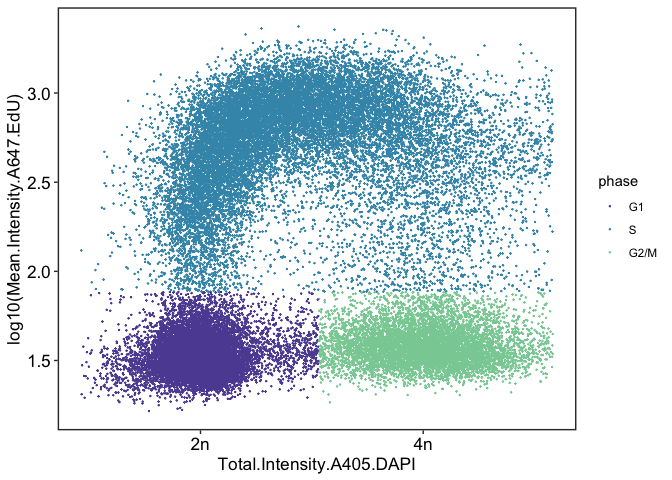
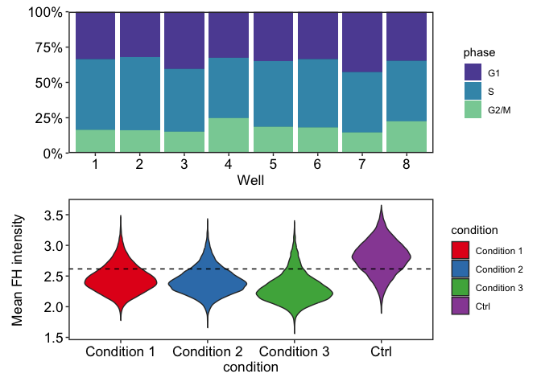

<!-- README.md is generated from README.qmd. Please edit that file -->

# QIBCR

<!-- badges: start -->

<!-- badges: end -->

QIBCR enables easy and nearly autonomous preprocessing and visualization
of QIBC data in R.

## Installation

You can install the development version of QIBCR from
[GitHub](https://github.com/) with:

``` r
# install.packages("remotes")
remotes::install_github("GKBlomquist/QIBCR")
```

## Example

Importing, down sampling, and inferring cell cycle phase.

Down sampling can be adjusted using the `max_size` parameter. Any well
with less cells than the specified `max_size` will retain all cells.

Cell cycle phase is automatically inferred through the
`infer_cycle_phases` function using gaussian mixture models. This may
fail in edge cases due to low amounts of cells in certain phases. In
this case, manually specify a threshold using the `thresholds` argument
in the function (run `?infer_cycle_phases` in the console for details).

``` r
library(QIBCR)
library(tidyverse)

QIBC_data <- read.delim("path/to/data.txt") %>% # replace with path to your QIBC data
  filter(Total.Intensity.A405.DAPI > 0.8e+06 & Total.Intensity.A405.DAPI < 4.5e+06) %>% 
  infer_cycle_phases() %>% 
  down_sample()
#> Inferring cycle phases using gaussian mixture models
#> Fitting EdU mixture model
#> Fitting DAPI mixture model on EdU-negative cells

table(QIBC_data$phase, QIBC_data$Well) # asses cell cycle distribution per well
#>             
#>                 1    2    3    4    5    6    7    8
#>   Background    0    0    0    0    0    0    0    0
#>   G1         1679 1617 2032 1640 1758 1676 2139 1738
#>   S          2501 2588 2219 2131 2318 2418 2137 2146
#>   G2/M        820  795  749 1229  924  906  724 1116
```

You can map wells to specific condition using the following approach:

``` r
well_to_condition <- list(
  "1" = "Ctrl",
  "2" = "Condition 1",
  "3" = "Condition 2",
  "4" = "Condition 3",
  "5" = "Ctrl",
  "6" = "Condition 1",
  "7" = "Condition 2",
  "8" = "Condition 3"
)

QIBC_data <- map_conditions(QIBC_data, well_to_condition)
```

QIBCR ships with built-in ggplot2 wrapper functions for easy
visualization, including color palette generation, and automatically
adjusting the x-axis to reflect DNA content.

``` r
ggplot(QIBC_data, aes(x = Total.Intensity.A405.DAPI, y = log10(Mean.Intensity.A647.EdU), color = phase))+
  geom_point(size = 0.1)+
  scale_x_DAPI(QIBC_data)+ # Adjusts axis labels to reflect DNA content
  scale_color_cycle() # Apply default cell cycle color palette
```



Remember, `ggplot2` is a highly flexible visualization framework,
enabling powerful plotting of QIBC data with just a few lines of code

``` r
library(patchwork)

ggplot(QIBC_data, aes(x = Well, y = 1, fill = phase))+
  geom_col(position = "fill")+
  scale_y_continuous(expand = c(0,0), labels = scales::percent, name = NULL)+
  scale_fill_cycle()+
  
ggplot(QIBC_data, aes(x = condition, y = log10(Mean.Intensity.A546.FH), fill = condition))+
  geom_violin()+
  scale_fill_manual(values = condition_colors)+
  geom_hline(yintercept = log10(mean(QIBC_data$Mean.Intensity.A546.FH)), linetype = "dashed")+
  labs(y = "Mean FH intensity")+
  plot_layout(ncol = 1)
```


